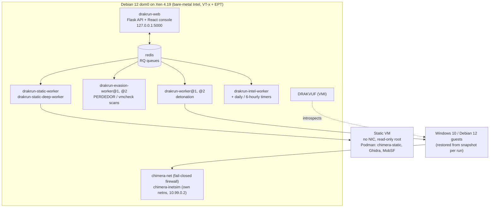

# CHIMERA handoff

The state of the project on **31 October 2026** and what anyone continuing it (a person or a coding agent) needs to
know before touching it. Read this first, then [README.md](README.md) and the
[documentation site](https://chimera-co.github.io/chimera/). Engineering detail and evidence live in
[`docs/chimera/`](docs/chimera/).

Maintainer: Shreyas Tekawade. The project was built by Shreyas Tekawade, Mantek Singh Burn and Anusha Tiwari; from
31 October 2026 Shreyas maintains it alone.

---

## 1. What the system is, in one screen



- **`drakrun/`**: the Python package. `drakrun/analyzer/` runs an analysis (restore VM, inject sample, attach
  DRAKVUF, collect, postprocess). `drakrun/lib/config.py` defines every config key and default. `drakrun/web/` is the
  API; `drakrun/web/frontend/` the React 19 + Vite console. `drakrun/evasion/` runs the verification scans.
- **`static_analyzer/`**: `chimera_static`, run inside a Podman container inside the static Xen VM. Rules are git
  submodules (`static_analyzer/capa-rules`, `static_analyzer/rules/reversinglabs/upstream`), pinned in
  `SOURCE.json` files; `static_analyzer/rules/README.md` explains updating them.
- **`classifier/`**: training and packaging of the verdict models. `classifier/RETRAIN.md` is the step-by-step v1
  retrain. The deployed model lives on the host in `/etc/drakrun/classifier/`, not in git.
- **`scripts/chimera/`**: host tooling. `containment/` (firewall, INetSim, `chimera-net-check`), `arms/` (guest
  hardening experiment arms and `chimera-arm`), `linux/` (Linux guest), `static-vm/` (static VM image and lifecycle),
  `intel/`, `mobsf/`, `patches/` (Xen and DRAKVUF patches), `systemd/` (unit files), `bench/`, `diag/`.
- **`perdedor/`**: submodule, the evasion self-test suite ([Chimera-Co/perdedor](https://github.com/Chimera-Co/perdedor)).
- **`drakvuf/`**: submodule. The *installed* DRAKVUF on the host is built separately (see §4), not from this pin.

## 2. Where things stand (31 Oct 2026)

**Done and deployed**

- Windows and Linux detonation with DRAKVUF, parallel analyses (two workers, per-OS queues, Xen memory admission).
- Fail-closed containment; test series C-1…C13 (Windows) and C0–C6 (Linux) pass
  ([results](docs/chimera/containment-results-2026-10-19.md)).
- Guest-freeze fix (Xen altp2m vs QEMU mapcache, [root cause](docs/chimera/vm-freeze-root-cause.md)) and a DRAKVUF
  use-after-free fix, merged upstream as tklengyel/drakvuf#1886.
- Guest hardening arm **H3** is live (host firmware IDs, phantom devices removed, everyday apps, `cpuidmon -s`,
  `hidsim`): PERDEDOR 100.0, al-khaser 20 detections per scan ([hardening-design.md](docs/chimera/hardening-design.md)).
- Static analysis in the isolated VM (fast pass + deep pass with capa, FLOSS, Ghidra), APK/IPA through MobSF.
- Classifier v0 (dynamic LightGBM + static EMBER2024 + fusion) deployed; **v1 retrain code is merged** and waits for a
  run on the machine with the WinMET data (`classifier/RETRAIN.md`).
- Threat intel: offline abuse.ch + warninglists bundle (daily timer), Maltrail trails (6-hourly), VirusTotal hash
  lookups.
- Long analyses (up to 24 h) and experimental sleep shortening (`delaymon`, off by default).
- Console Home and Docs pages with the demo video; the same pages publish to GitHub Pages.

**Open items, in rough priority order**

1. **Classifier v1**: run `classifier/RETRAIN.md` on the WinMET machine, install the zip it produces into
   `/etc/drakrun/classifier/`, then evaluate once on the held-out Stage 1 runs. v0 says "benign" for most CHIMERA
   malware runs (`docs/chimera/plan/classifier-audit.md`); don't present v0 verdicts as accurate.
2. **Xen upgrade** (deliberately deferred until the project report and paper are final): the host runs Xen 4.19.2
   plus the altp2m patch; later 4.19.x releases carry security fixes. Rebuild on the newest 4.19.x with
   `scripts/chimera/patches/`, then rerun the 25-run reliability check before trusting results again. Every
   published number was measured on 4.19.2.
3. **Upstream the Xen altp2m patch** to xen-devel (patch prepared; needs a build check on Xen staging first).
4. **60-minute runs skip capa on dynamic logs** (logs ~530 MB > `capa.max_dynamic_log_mb` 250), so long runs have no
   `ttps.json`. Needs streaming or sampling of the log.
5. **Process start time** shows a large negative number for processes that started before the trace.
6. **Side-loading DLL samples** (e.g. BumbleBee, ValleyRAT `winhttp.dll`) do not execute when uploaded as `.exe`;
   they need a `rundll32` start command or a host process.
7. **Deep static pass** on large installers: FLOSS can hit its memory limit (caught, exit 0), and a deep job holds
   the static VM about 8 minutes.
8. Remaining al-khaser detections (WMI sensors, ACPI/SMBIOS table counts, Hyper-V objects, `parent_is_explorer`,
   RDTSC VM-exit cost): residuals documented in `hardening-design.md` §6–7. Do not re-chase CPUID or mouse checks.
9. Future scope (after 31 Oct): URL analysis mode, further anti-evasion work, iOS dynamic analysis (Corellium,
   opt-in). Android dynamic analysis landed 8 Nov: `docs/chimera/mobile-dynamic.md`. See the
   [limitations page](https://chimera-co.github.io/chimera/#/docs/limitations) and `docs/chimera/plan/roadmap.md`.

## 3. The host in production

| Item | Value |
|---|---|
| Hardware | 16 logical CPUs, 16 GiB RAM (dom0 6 GiB; Windows guest 5 GiB, Linux 4 GiB, static VM 3.5 GiB) |
| Boot | GRUB's default is plain Debian; the Xen entry is picked by hand. After a reboot check that `chimera-inetsim` and `drakrun-web` are up |
| Deployed source | `/opt/chimera/src` (root-owned checkout) installed into `/opt/chimera/venv` |
| Config | `/etc/drakrun/config.toml` (keep a dated `.bak-*` copy before every change) |
| Data | `/var/lib/drakrun/` (analyses), `/var/lib/chimera-arms/` (guest images; `CURRENT` names the live arm), `/var/lib/chimera-static-vm/` |
| Services | `chimera-net`, `chimera-inetsim`, `chimera-xenstat`, `drakrun-web`, `drakrun-worker@1/@2`, `drakrun-evasion-worker@1/@2`, `drakrun-static-worker`, `drakrun-static-deep-worker`, `drakrun-intel-worker`, `redis-server`; timers `chimera-intel-update`, `chimera-trails-sync`, `chimera-static-vm-idle` |
| Web | gunicorn on 127.0.0.1:5000 only (no login of its own); reach it through an SSH tunnel |

Health check before anything else:

```bash
xl info | grep -E 'xen_version|cc_compile_date'          # patched Xen is live
cat /var/lib/chimera-arms/CURRENT                          # expect H3
sudo chimera-net-check --require-inetsim                   # containment must pass
systemctl --failed; systemctl list-units 'drakrun*' 'chimera*'
```

## 4. Deploying a change

The production host deploys from `/opt/chimera/src`, never from a user-writable directory.

1. Develop and test on a branch; merge to `master`.
2. Back up first: the venv site-packages (`tar czf /opt/chimera/backup-site-<name>-<date>.tgz …`), the config, and the
   frontend `dist/` (rename to `dist.prev-<date>`).
3. Update `/opt/chimera/src`, run `make` (console, drakshell, wheel), then
   `/opt/chimera/venv/bin/pip install --no-deps --force-reinstall dist/*.whl`.
4. Restart the affected units (`drakrun-web` after any plugin or config change, the workers after analyzer
   changes). Never restart workers while an analysis is running; check `/api/list` or the console first.
5. Smoke test: one benign upload of a few minutes; check the report, `static.json` and the classifier result.
6. Static image changes: `podman build --network=host …` (a plain `podman build` inserts a netavark FORWARD rule above
   the CHIMERA guard and `chimera-net-check` then fails), then `scripts/chimera/static-vm/build-image.sh --images`
   reloads the VM disk (back up `root.img` first).
7. Guest snapshot changes (`modify-vm0 … commit`): before committing, check explorer's parent and job state and that
   Defender is still off (scripts under `scripts/chimera/arms/H1/`). A wrong explorer state shows up as al-khaser
   detections in every later analysis.

Installed DRAKVUF is `/usr/local/bin/drakvuf`, built from upstream with the patches in `scripts/chimera/patches/`
(build guide step 2). Keep the previous binary next to it when replacing it.

## 5. Tests

```bash
.venv/bin/python -m pytest --confcutdir=test/unit test/unit             # drakrun, ~930 tests
cd classifier && .venv/bin/python -m pytest -q tests                     # classifier (own venv, requirements-train.txt)
podman build --network=host --target test -f static_analyzer/Containerfile static_analyzer   # static analyzer
cd drakrun/web/frontend && npx vitest run && npx eslint src              # console
```

All must pass before merging. Changes to containment, the analyzer, the guest lifecycle or DRAKVUF integration also
need a run on the real host: the containment check, one Windows and one Linux benign analysis, and for hardening
changes an evasion scan (`docs/chimera/hardening-design.md` describes the protocol).

## 6. Rules that are not obvious from the code

- **Evidence before conclusions.** Report what was measured, with the command or file it came from. A mechanism
  inside a guest counts as working only when a run shows it working, not when the code to do it exists.
- **Containment is never weakened** to make something work. If `chimera-net-check` fails, nothing is detonated.
- **Samples never leave the host.** Threat-intel lookups send hashes only. Never upload samples anywhere, never commit
  them, their hash registers, analysis output from real malware, keys (`/etc/chimera/*`), or archive passwords.
- **abuse.ch / MalwareBazaar rate limits** lock the key out for 72 hours: keep queries few and cache results.
- **Long jobs** (scan series, batches) run as `systemd-run --unit chimera-<name>` units, never as shells tied to a
  terminal session, and only on AC power. After a power loss: `qemu-img check` the arm images,
  `chimera-net-check --require-inetsim`, worker states, `CURRENT` arm.
- **Evasion suites under DRAKVUF**: tool time budgets count from staging, and some VM-detection tools can crash the
  guest; run new tools on a throwaway arm first.
- **Some findings are under coordinated disclosure.** Ask the maintainer before publishing any new crash or
  vulnerability detail about Xen, DRAKVUF or the guests.
- **Guest credentials** are the maintainer's: automation never types the guest login.
- **Commits**: plain messages describing what changed and why; no `Co-authored-by` trailers. Credit CERT Polska
  (DRAKVUF Sandbox) and Tamas K Lengyel (DRAKVUF) and keep the licence.

## 7. Repository, branches and history

- Repository: <https://github.com/Chimera-Co/chimera>, default branch `master`. It began as a fork of
  CERT-Polska/drakvuf-sandbox (v0.21.0); the full history is kept. The old fork `Chimera-Co/drakvuf-sandbox` is
  archived.
- Other branches (sprint, feature and experiment branches such as `sprint/final`, `classifier-retrain`,
  `evasion/drakvuf-attach`, `evasion/hardening`) are merged or superseded and kept for history; work from `master`.
- Documentation site: built from `drakrun/web/frontend` (`npm run build:site`) and published by
  `.github/workflows/pages.yml` on pushes to `master` that touch the frontend.
- Demo video: `drakrun/web/frontend/public/chimera-demo.mp4` (720p, played by the console and the site); the 1080p
  original is a release asset (`demo-2026-10-31`).

## 8. Where to read more

| Topic | File |
|---|---|
| Day-by-day log of the October sprint | [`docs/chimera/journal.md`](docs/chimera/journal.md) |
| State snapshot, test counts, host facts | [`docs/chimera/plan/current-state.md`](docs/chimera/plan/current-state.md) |
| Roadmap and hardening roadmap | [`docs/chimera/plan/roadmap.md`](docs/chimera/plan/roadmap.md), [`hardening-roadmap.md`](docs/chimera/plan/hardening-roadmap.md) |
| Threat model, containment design and results | [`threat-model.md`](docs/chimera/threat-model.md), [`containment-proposal.md`](docs/chimera/containment-proposal.md), [`containment-results-2026-10-19.md`](docs/chimera/containment-results-2026-10-19.md) |
| Guest freeze root cause | [`vm-freeze-root-cause.md`](docs/chimera/vm-freeze-root-cause.md) |
| Hardening | [`hardening-design.md`](docs/chimera/hardening-design.md), [`linux-evasion.md`](docs/chimera/linux-evasion.md) |
| Static analysis | [`static-analysis.md`](docs/chimera/static-analysis.md), [`plan/static-engine-design.md`](docs/chimera/plan/static-engine-design.md) |
| Classifier | [`classifier-interface.md`](docs/chimera/classifier-interface.md), [`plan/classifier-audit.md`](docs/chimera/plan/classifier-audit.md), [`classifier/RETRAIN.md`](classifier/RETRAIN.md) |
| Threat intel | [`intel-offline.md`](docs/chimera/intel-offline.md), [`intel-online.md`](docs/chimera/intel-online.md), [`intel-maltrail.md`](docs/chimera/intel-maltrail.md) |
| Evaluation protocol | [`malware-evaluation-protocol.md`](docs/chimera/malware-evaluation-protocol.md) |
