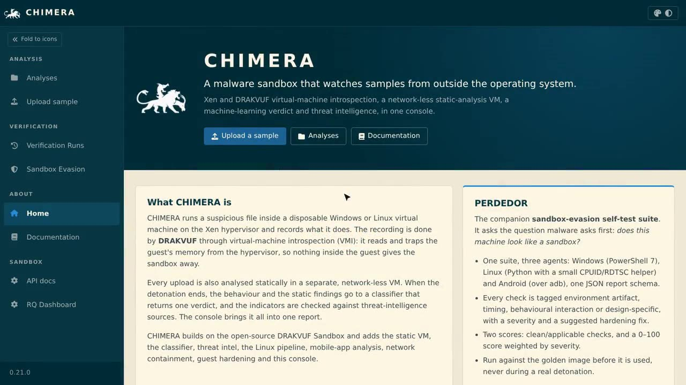
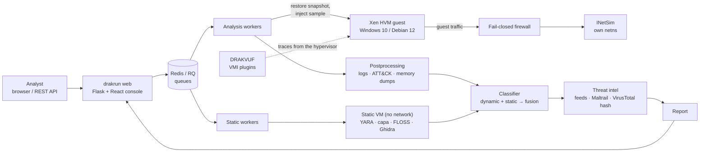
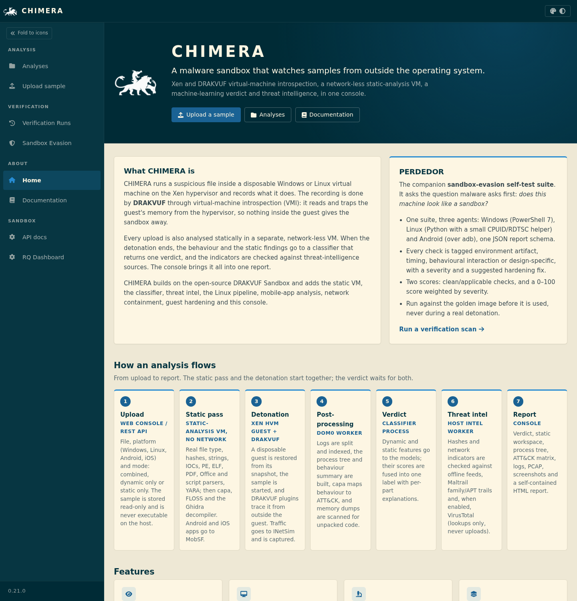
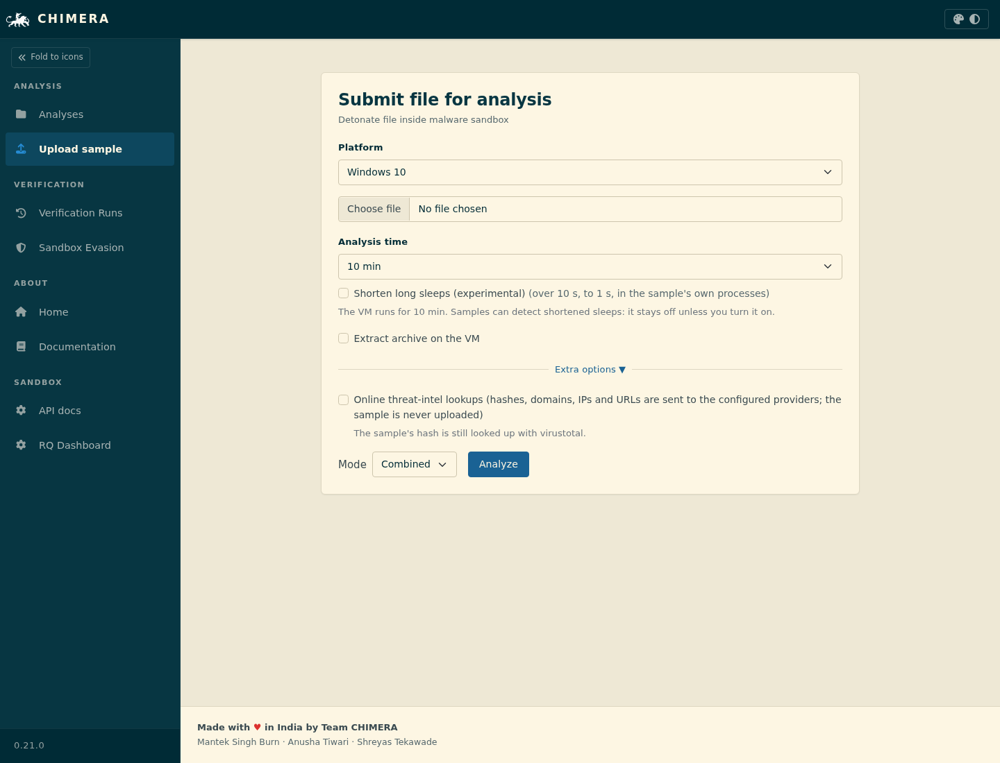
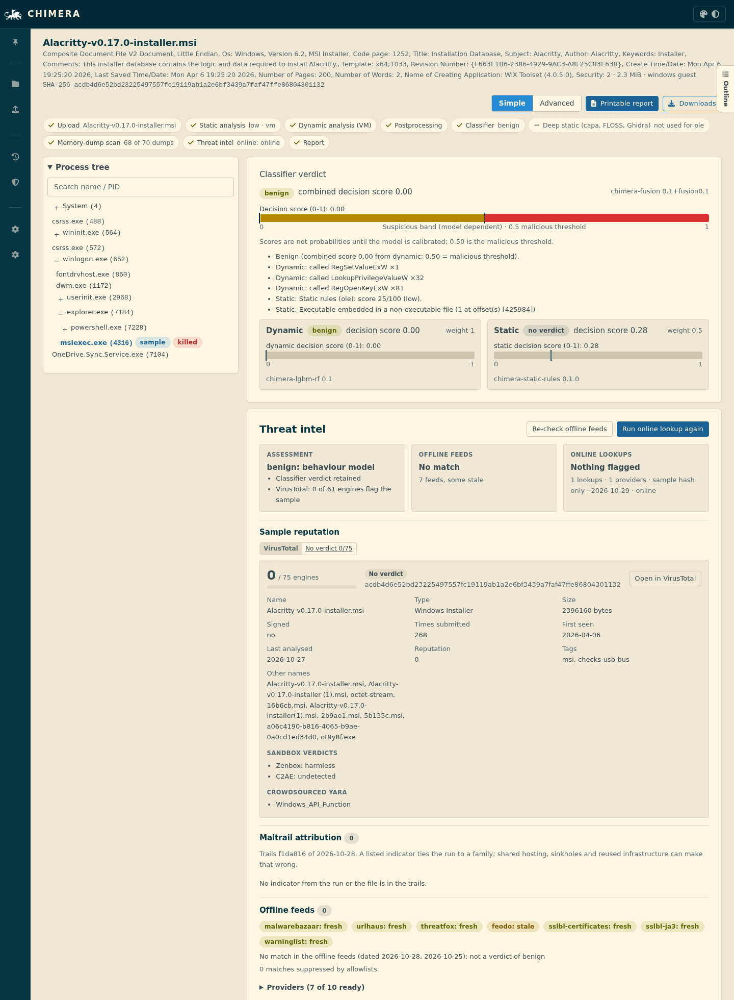
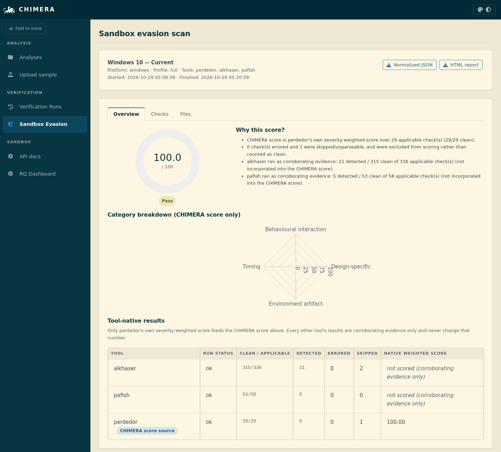
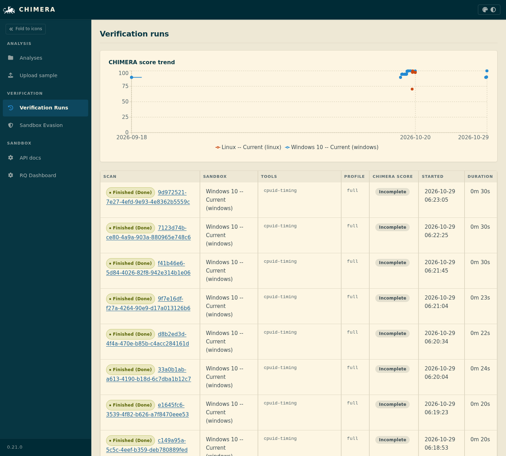
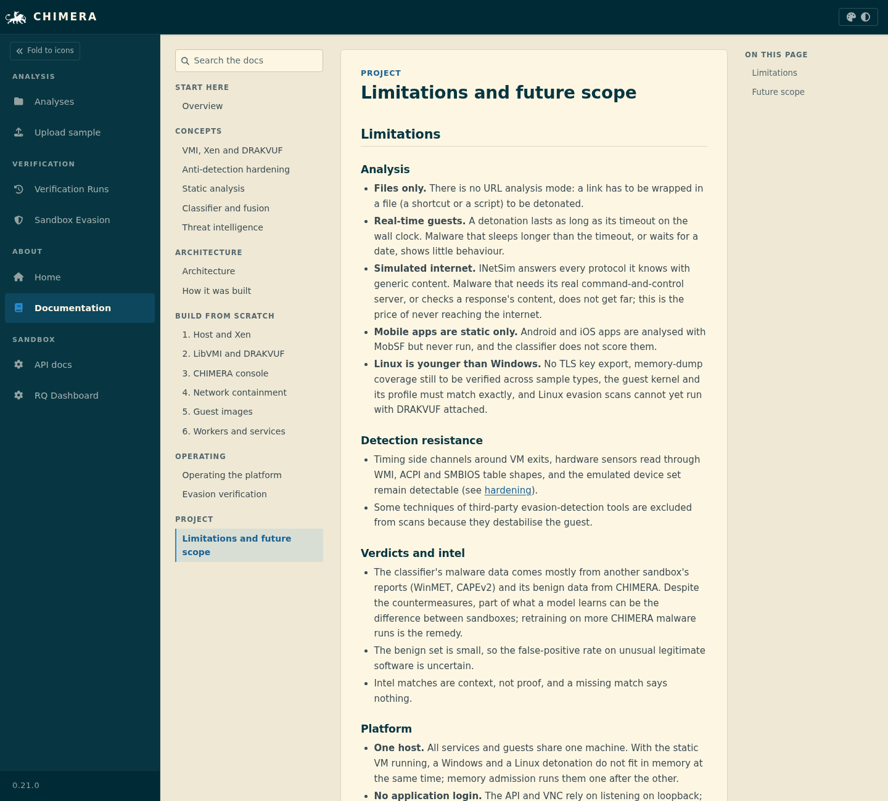

<div align="center">


# CHIMERA

**An agentless malware sandbox that watches samples from outside the operating system.**

Xen + DRAKVUF virtual-machine introspection · a network-less static-analysis VM · a fused machine-learning verdict ·
threat intelligence · one analyst console

[**Documentation**](https://chimera-co.github.io/chimera/) ·
[**Demo video**](https://chimera-co.github.io/chimera/) ·
[Build guide](https://chimera-co.github.io/chimera/#/docs/build-host-xen) ·
[Architecture](https://chimera-co.github.io/chimera/#/docs/architecture) ·
[PERDEDOR](https://github.com/Chimera-Co/perdedor)

</div>

---

CHIMERA runs a suspicious file inside a disposable Windows 10 or Debian 12 virtual machine on the Xen hypervisor and
records what it does. The recording is done by [DRAKVUF](https://drakvuf.com/) through virtual-machine
introspection: it reads and traps guest memory from the hypervisor, so there is no monitoring agent inside the guest
for malware to find. Every upload is also analysed statically in a separate VM that has no network interface. When
the detonation ends, a classifier fuses the behaviour and the static findings into one verdict, the indicators are
checked against threat-intelligence sources, and the console shows the whole result in one report.

CHIMERA builds on [DRAKVUF Sandbox](https://github.com/CERT-Polska/drakvuf-sandbox) by CERT Polska and keeps its
licence. **PERDEDOR**, the companion sandbox-evasion self-test suite, measures how much a golden image still looks
like a sandbox and drives the guest hardening.

## See it in action

[](https://chimera-co.github.io/chimera/)

*Ten-minute walkthrough: submitting a sample, the live VM view, the report with its verdict and threat intelligence,
static analysis and the evasion self-test. Click to watch it on the documentation site; the 1080p file is attached to
the [demo release](https://github.com/Chimera-Co/chimera/releases/tag/demo-2026-10-31).*

## Features

| | |
|---|---|
| **Agentless tracing** | DRAKVUF records processes, API calls, files, registry, sockets, TLS keys and memory dumps from the hypervisor. |
| **Windows and Linux guests** | Windows 10 and a Debian 12 desktop, restored from a clean snapshot for every run and destroyed afterwards; live VNC view and screenshots. |
| **Static analysis in an isolated VM** | Content-based type detection (PE, ELF, Mach-O, PDF, Office, RTF, LNK, archives, scripts), format parsers, YARA, capa, FLOSS and Ghidra, inside a Xen guest with no NIC and a read-only disk. Android APK and iOS IPA through MobSF. |
| **Android dynamic analysis** | APKs run in an Android-x86 9 guest under Xen with MobSF's dynamic analyzer and Frida (API monitor, SSL-pinning and anti-emulator bypasses), screenshots, logcat and a PCAP, behind the simulated internet. |
| **Memory-dump scanning** | Regions DRAKVUF dumps during the run (injected or unpacked code) go through the same analyzers, including malware-configuration extraction (CERT Polska's malduck: njRAT, Remcos, REvil, Cobalt Strike, GraphicalProton) whose C2 addresses feed the threat intel. |
| **Fused ML verdict** | A behaviour model (LightGBM) and per-format file models (EMBER2024) score separately; the fusion returns one label with the reasons from each part, and abstains when it cannot judge. |
| **Threat intelligence** | Offline abuse.ch feeds and MISP warninglists, Maltrail family/APT attribution, and VirusTotal hash lookups. Samples are never uploaded. |
| **Fail-closed network containment** | Guests reach only INetSim in its own network namespace; anything else is dropped and logged. Full PCAP per run. |
| **Anti-detection hardening** | Real firmware and hardware identities, hidden hypervisor CPUID leaves, simulated user input and a lived-in guest, measured with PERDEDOR, al-khaser and Pafish. |
| **Long analyses** | Runs from 1 minute up to 24 hours, with optional (experimental) shortening of long sleeps in the sample's own processes. |
| **Reports and API** | ATT&CK matrix, process tree, per-process logs, decompiled code, IOC export, a self-contained HTML report and a REST API with OpenAPI docs. |

## Architecture



Every analysis gets a fresh guest from a snapshot; the static pass and the detonation start together and the verdict
waits for both. Details: [architecture](https://chimera-co.github.io/chimera/#/docs/architecture) and
[network containment](https://chimera-co.github.io/chimera/#/docs/build-network).

## Screenshots

| | |
|---|---|
|  |  |
| **Home**: what CHIMERA is and how an analysis flows | **Upload**: guest OS, analysis time, options |
|  |  |
| **Report**: verdict, threat intel, process tree (benign installer shown) | **Evasion scan**: PERDEDOR, al-khaser and Pafish on the hardened image |
|  |  |
| **Verification runs**: hardening scores over time | **Docs**: the same pages as the documentation site |

## What has been measured

Results recorded on the development host; each links to its evidence.

- **Containment.** The Windows (C-1…C13) and Linux (C0–C6) containment test series pass: guests reach INetSim only,
  spoofed and LAN-bound traffic is dropped, and `chimera-net-check` refuses to start analyses otherwise
  ([results](docs/chimera/containment-results-2026-10-19.md)).
- **Reliability.** A guest freeze under DRAKVUF's altp2m was traced to a deadlock between Xen and QEMU and fixed with a
  small Xen patch ([root cause](docs/chimera/vm-freeze-root-cause.md)); a DRAKVUF use-after-free found here was fixed
  upstream ([tklengyel/drakvuf#1886](https://github.com/tklengyel/drakvuf/pull/1886)).
- **Hardening.** On the Windows golden image the PERDEDOR v1 check score rose from 89.48 to 100.0 and al-khaser
  detections fell from 26–27 to 20 per scan ([design and remaining detections](docs/chimera/hardening-design.md)).
  PERDEDOR v2 scores far more strictly: its exposure score estimates the share of known evasive malware that would run
  normally, and the same image with DRAKVUF attached scores 22.8/100, with firmware, hardware and network identity the
  largest remaining losses ([how the score works](https://chimera-co.github.io/perdedor/SCORING/)); on the Linux image
  the evasion score rose from 70.44 to 97.42 ([Linux sandbox](docs/chimera/linux-sandbox.md)).
- **Limits** are written down too: [limitations and future scope](https://chimera-co.github.io/chimera/#/docs/limitations).

## Getting started

CHIMERA needs a bare-metal Intel host with VT-x and EPT, Xen 4.19 and Debian 12. Cloud VMs, nested hypervisors and
macOS hosts do not work, because DRAKVUF needs the hardware virtualisation features directly.

```bash
git clone --recursive https://github.com/Chimera-Co/chimera.git
```

Use `--recursive`: DRAKVUF, PERDEDOR, the capa rules and the YARA rules are git submodules, and a "Download ZIP" of
this page does not contain them.

The [build guide](https://chimera-co.github.io/chimera/#/docs/build-host-xen) goes from a blank Debian host to a working
sandbox: [Xen](https://chimera-co.github.io/chimera/#/docs/build-host-xen),
[DRAKVUF](https://chimera-co.github.io/chimera/#/docs/build-drakvuf),
[the console](https://chimera-co.github.io/chimera/#/docs/build-console),
[the network](https://chimera-co.github.io/chimera/#/docs/build-network),
[the guests](https://chimera-co.github.io/chimera/#/docs/build-guests) and
[the services](https://chimera-co.github.io/chimera/#/docs/build-services). Then read
[operating](https://chimera-co.github.io/chimera/#/docs/operating) and
[verification](https://chimera-co.github.io/chimera/#/docs/verification).

## Repository layout

| Path | What it holds |
|---|---|
| `drakrun/` | The sandbox service: analysis worker, postprocessing, classifier runner, threat intel, REST API |
| `drakrun/web/frontend/` | The React console; its Home and Docs pages also build the [documentation site](https://chimera-co.github.io/chimera/) |
| `static_analyzer/` | The static analyzer (runs in the isolated static VM), its YARA and capa rule submodules, and its image |
| `classifier/` | Training, calibration and packaging of the verdict models ([RETRAIN.md](classifier/RETRAIN.md)) |
| `scripts/chimera/` | Host setup: containment, guest hardening, Linux and static VMs, systemd units, evaluation tooling |
| `perdedor/` | [PERDEDOR](https://github.com/Chimera-Co/perdedor) submodule: the sandbox-evasion self-test suite |
| `drakvuf/` | DRAKVUF submodule |
| `docs/chimera/` | Engineering notes: designs, test results, threat model, root-cause write-ups |
| `test/` | Unit and integration tests |
| [`HANDOFF.md`](HANDOFF.md) | State of the project and how to continue it |

## Development

```bash
python3 -m venv .venv && .venv/bin/pip install -e .
.venv/bin/python -m pytest --confcutdir=test/unit test/unit     # backend unit tests
cd drakrun/web/frontend && npm ci
npx vitest run                                                  # console tests
npm run build:site                                              # documentation site -> dist-site/
```

See [CONTRIBUTING.md](CONTRIBUTING.md) and [HANDOFF.md](HANDOFF.md).

## Safety

CHIMERA executes live malware. Run it only on a dedicated host you are allowed to use for that, keep the containment
checks green, never upload samples to third parties, and keep samples, keys and sample registers out of git.

## Credits and licence

CHIMERA was built by **Shreyas Tekawade** ([@shreyastek](https://github.com/shreyastek)), **Mantek Singh Burn**
([@clustercoder](https://github.com/clustercoder)) and **Anusha Tiwari**
([@anushatiwari27](https://github.com/anushatiwari27)), and is maintained by Shreyas Tekawade and Mantek Singh Burn.

It stands on [DRAKVUF Sandbox](https://github.com/CERT-Polska/drakvuf-sandbox) by CERT Polska,
[DRAKVUF](https://github.com/tklengyel/drakvuf) and LibVMI by Tamas K Lengyel, [Xen](https://xenproject.org/),
[capa](https://github.com/mandiant/capa) and its rules, the
[ReversingLabs YARA rules](https://github.com/reversinglabs/reversinglabs-yara-rules),
[EMBER2024](https://github.com/FutureComputing4AI/EMBER2024), [INetSim](https://www.inetsim.org/), MobSF and Maltrail,
and CERT Polska's [malduck](https://github.com/CERT-Polska/malduck) with its
[modules](https://github.com/CERT-Polska/malduck-modules), [hfinger](https://github.com/CERT-Polska/hfinger) and
[warning list](https://hole.cert.pl/).

Licensed under the terms in [LICENSE](LICENSE). Submodules and bundled components keep their own licences.
